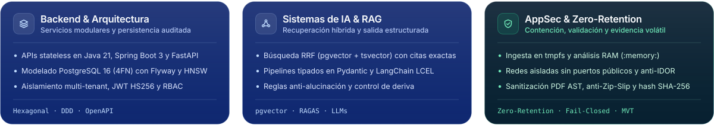
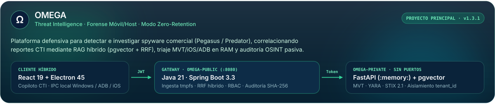
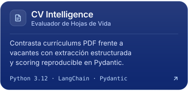

<picture><source media="(prefers-color-scheme: dark)" srcset="./assets/v8/hero-dark.svg" /><source media="(prefers-color-scheme: light)" srcset="./assets/v8/hero-light.svg" /></picture>

 

Desarrollo plataformas backend e inteligencia artificial aplicada a seguridad defensiva (`Java 21`, `Python`, `PostgreSQL`), con foco en trazabilidad verificable y aislamiento de datos sensibles.  
En transición hacia **Cloud Security** y **AI Security Engineering** para diseñar servicios resilientes desde la arquitectura hasta el despliegue.

 

### Capacidades Técnicas

<picture><source media="(prefers-color-scheme: dark)" srcset="./assets/v8/capabilities-dark.svg" /><source media="(prefers-color-scheme: light)" srcset="./assets/v8/capabilities-light.svg" /></picture>

  

### Proyectos Destacados

<a href="https://github.com/andresguerra321/OMEGA"><picture><source media="(prefers-color-scheme: dark)" srcset="./assets/v8/omega-featured-dark.svg" /><source media="(prefers-color-scheme: light)" srcset="./assets/v8/omega-featured-light.svg" /></picture></a>

  

`Java 21` `Spring Boot 3` `FastAPI` `pgvector` `React 19` `Electron`

**[Ver repositorio](https://github.com/andresguerra321/OMEGA)** · **[Arquitectura Zero-Retention](https://github.com/andresguerra321/OMEGA/blob/main/omega/backend-java/README.md)** · **[Evaluación RAGAS](https://github.com/andresguerra321/OMEGA/blob/main/omega/rag_engine/eval/ablation_report_v1.md)** · **[Release Desktop v1.3.1](https://github.com/andresguerra321/OMEGA/releases/tag/v1.3.1)**

 

  <a href="https://github.com/andresguerra321/GUARDIAN"><picture><source media="(prefers-color-scheme: dark)" srcset="./assets/v8/sec-guardian-dark.svg" /><source media="(prefers-color-scheme: light)" srcset="./assets/v8/sec-guardian-light.svg" /></picture></a>&nbsp;&nbsp;&nbsp;<a href="https://github.com/andresguerra321/HOJAS-DE-VIDA"><picture><source media="(prefers-color-scheme: dark)" srcset="./assets/v8/sec-cv-dark.svg" /><source media="(prefers-color-scheme: light)" srcset="./assets/v8/sec-cv-light.svg" /></picture></a>&nbsp;&nbsp;&nbsp;<a href="https://github.com/andresguerra321/proyecto-springboot"><picture><source media="(prefers-color-scheme: dark)" srcset="./assets/v8/sec-toolrent-dark.svg" /><source media="(prefers-color-scheme: light)" srcset="./assets/v8/sec-toolrent-light.svg" /></picture></a>

 

### Ahora

- Endurecimiento continuo de **OMEGA** (`v1.3.1`): aislamiento entre gateway Java y worker forense, integridad de corpus CTI y evaluación de RAG con citas verificables.
- Explorando diseño de **AI Security Gateway** y fundamentos de **Cloud Security** (control de acceso, validación de entradas en pipelines LLM y segmentación de redes).

---

  <a href="https://portfolio.agengineering.workers.dev/"><picture><source media="(prefers-color-scheme: dark)" srcset="./assets/v8/btn-portfolio-dark.svg" /><source media="(prefers-color-scheme: light)" srcset="./assets/v8/btn-portfolio-light.svg" /></picture></a>&nbsp;
  <a href="https://www.linkedin.com/in/andr%C3%A9s-felipe-guerra-correa-556333267/"><picture><source media="(prefers-color-scheme: dark)" srcset="./assets/v8/btn-linkedin-dark.svg" /><source media="(prefers-color-scheme: light)" srcset="./assets/v8/btn-linkedin-light.svg" /></picture></a>&nbsp;
  <a href="mailto:andres.felipe.gueco@gmail.com"><picture><source media="(prefers-color-scheme: dark)" srcset="./assets/v8/btn-email-dark.svg" /><source media="(prefers-color-scheme: light)" srcset="./assets/v8/btn-email-light.svg" /></picture></a>&nbsp;
  <a href="https://es.fiverr.com/s/dDvmP03"><picture><source media="(prefers-color-scheme: dark)" srcset="./assets/v8/btn-fiverr-dark.svg" /><source media="(prefers-color-scheme: light)" srcset="./assets/v8/btn-fiverr-light.svg" /></picture></a>&nbsp;
  <a href="https://wa.me/573185602203"><picture><source media="(prefers-color-scheme: dark)" srcset="./assets/v8/btn-whatsapp-dark.svg" /><source media="(prefers-color-scheme: light)" srcset="./assets/v8/btn-whatsapp-light.svg" /></picture></a>

Andrés Felipe Guerra · Bucaramanga, Colombia

