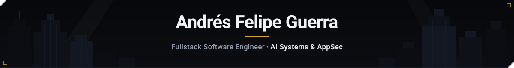
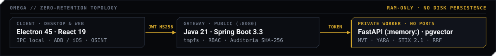

<picture><source media="(prefers-color-scheme: dark)" srcset="./assets/v9/hero-dark.svg" /><source media="(prefers-color-scheme: light)" srcset="./assets/v9/hero-light.svg" /></picture>

Backend en **Java 21** y **Python**, sistemas de **IA** y seguridad defensiva — rumbo a **Cloud & AI Security**.

### Capacidades

- **Backend** · Java 21, Spring Boot 3 y FastAPI · PostgreSQL 16 (4FN, Flyway, HNSW) · Hexagonal & DDD
- **IA & RAG** · Búsqueda híbrida (`pgvector` + RRF) · Pydantic · LangChain LCEL · Evaluación RAGAS
- **AppSec** · Zero-Retention (`tmpfs`, `:memory:`) · JWT HS256 y RBAC · Aislamiento multi-tenant y sanitización AST

### Proyectos Destacados

**[OMEGA](https://github.com/andresguerra321/OMEGA)** — *Threat Intelligence & Forense Zero-Retention (`v1.3.1`)*  
Correlación de spyware comercial (*Pegasus / Predator*) mediante RAG híbrido (`pgvector` + RRF), triaje forense en RAM (MVT, ADB/iOS) y auditoría OSINT pasiva.

<picture><source media="(prefers-color-scheme: dark)" srcset="./assets/v9/omega-arch-dark.svg" /><source media="(prefers-color-scheme: light)" srcset="./assets/v9/omega-arch-light.svg" /></picture>

`Java 21` `Spring Boot 3` `FastAPI` `pgvector` `React 19` `Electron`  
**[Repositorio](https://github.com/andresguerra321/OMEGA)** · **[Arquitectura Zero-Retention](https://github.com/andresguerra321/OMEGA/blob/main/omega/backend-java/README.md)** · **[Evaluación RAGAS](https://github.com/andresguerra321/OMEGA/blob/main/omega/rag_engine/eval/ablation_report_v1.md)** · **[Release v1.3.1](https://github.com/andresguerra321/OMEGA/releases/tag/v1.3.1)**

 

- **[GUARDIAN](https://github.com/andresguerra321/GUARDIAN)** — Seguridad vial multi-agente con Computer Vision (`Python`, `Voxel51 FiftyOne`, `Gemini AI`)
- **[CV Intelligence](https://github.com/andresguerra321/HOJAS-DE-VIDA)** — Contraste estructurado de CVs frente a vacantes (`Python 3.12`, `LangChain`, `Pydantic`)
- **[ToolRent](https://github.com/andresguerra321/proyecto-springboot)** — SaaS de renta industrial en 8 módulos Maven (`Java 17`, `Spring Boot 3`, `PostgreSQL 4FN`, `JWT`)

### Ahora

- **OMEGA (`v1.3.1`)** — Endurecimiento de aislamiento gateway/worker e integridad de corpus CTI.
- **Cloud & AI Security** — Diseño de **AI Security Gateway** y control de acceso en pipelines LLM.

 

  <a href="https://portfolio.agengineering.workers.dev/"><picture><source media="(prefers-color-scheme: dark)" srcset="./assets/v9/btn-portfolio-dark.svg" /><source media="(prefers-color-scheme: light)" srcset="./assets/v9/btn-portfolio-light.svg" /></picture></a>&nbsp;
  <a href="https://www.linkedin.com/in/andr%C3%A9s-felipe-guerra-correa-556333267/"><picture><source media="(prefers-color-scheme: dark)" srcset="./assets/v9/btn-linkedin-dark.svg" /><source media="(prefers-color-scheme: light)" srcset="./assets/v9/btn-linkedin-light.svg" /></picture></a>&nbsp;
  <a href="mailto:andres.felipe.gueco@gmail.com"><picture><source media="(prefers-color-scheme: dark)" srcset="./assets/v9/btn-email-dark.svg" /><source media="(prefers-color-scheme: light)" srcset="./assets/v9/btn-email-light.svg" /></picture></a>&nbsp;
  <a href="https://es.fiverr.com/s/dDvmP03"><picture><source media="(prefers-color-scheme: dark)" srcset="./assets/v9/btn-fiverr-dark.svg" /><source media="(prefers-color-scheme: light)" srcset="./assets/v9/btn-fiverr-light.svg" /></picture></a>&nbsp;
  <a href="https://wa.me/573185602203"><picture><source media="(prefers-color-scheme: dark)" srcset="./assets/v9/btn-whatsapp-dark.svg" /><source media="(prefers-color-scheme: light)" srcset="./assets/v9/btn-whatsapp-light.svg" /></picture></a>

Andrés Felipe Guerra · Bucaramanga, Colombia

