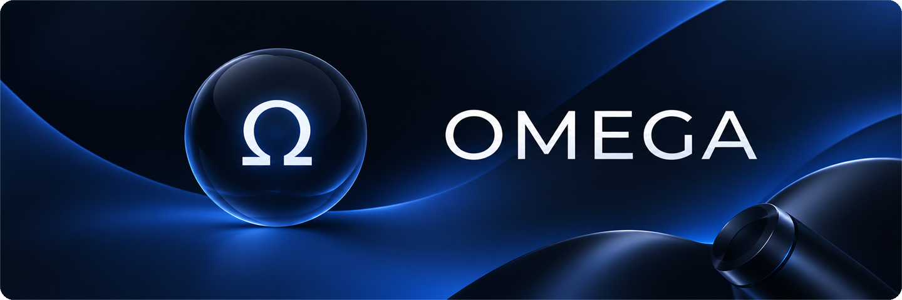
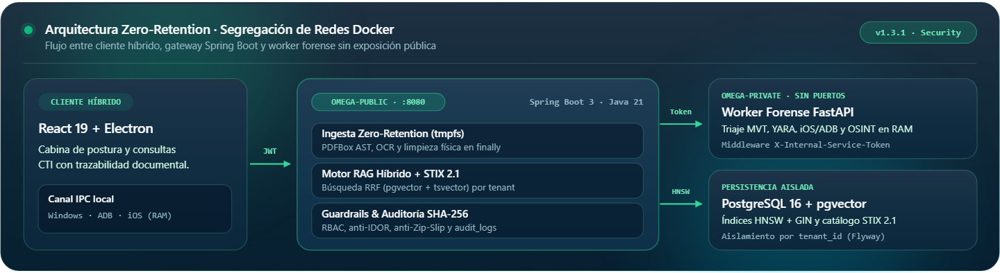
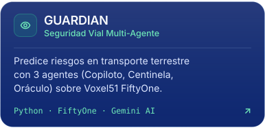
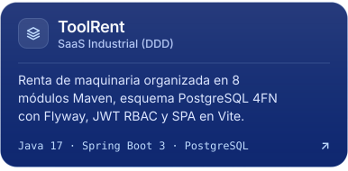

<picture><source media="(prefers-color-scheme: dark)" srcset="./assets/v7/hero-dark.svg" /><source media="(prefers-color-scheme: light)" srcset="./assets/v7/hero-light.svg" /></picture>

 

Construyo plataformas backend e inteligencia artificial aplicada a seguridad defensiva (`Java 21`, `Python`, `PostgreSQL`), con foco en trazabilidad verificable y aislamiento de datos sensibles.  
En transición hacia **Cloud Security** y **AI Security Engineering** para diseñar servicios resilientes desde la arquitectura hasta el despliegue.

---

## OMEGA · Inteligencia defensiva contra spyware comercial

  

 

Plataforma defensiva de *threat intelligence* orientada a detectar y analizar spyware comercial (tipo Pegasus) mediante correlación CTI, triaje forense (`MVT`, `iOS`/`ADB`), auditoría OSINT y RAG híbrido (`pgvector` + `RRF`) en modo **Zero-Retention**.

<!-- TODO: reemplaza estos tres puntos con tus definiciones verificadas en una línea -->
- **Problema:** <!-- TODO: una línea sobre el problema concreto que resuelve OMEGA (p. ej. fricción y exposición al correlacionar reportes CTI y volcados móviles sin infraestructura aislada) -->
- **Enfoque (`Zero-Retention`):** Búsqueda híbrida (`pgvector` + `RRF`) sobre fuentes CTI y worker forense separado por red interna. <!-- TODO: una línea precisando qué garantiza exactamente Zero-Retention sobre artefactos y memoria -->
- **Estado (`v1.3.1`):** <!-- TODO: una línea indicando qué funciona hoy de extremo a extremo y cuál es el siguiente hito -->

<!-- TODO: reemplaza ./assets/omega-screenshot.png por una captura real de la interfaz principal cuando quieras mostrar la UI (sugerido 1200×675 px) -->

  

 

`Java 21` `Spring Boot 3` `FastAPI` `pgvector` `React 19` `Electron`

**[Ver repositorio](https://github.com/andresguerra321/OMEGA)** · **[Arquitectura](https://github.com/andresguerra321/OMEGA/blob/main/omega/backend-java/README.md)** · **[Demo / Release v1.3.1](https://github.com/andresguerra321/OMEGA/releases/tag/v1.3.1)**

 

### Proyectos secundarios

  <a href="https://github.com/andresguerra321/GUARDIAN"><picture><source media="(prefers-color-scheme: dark)" srcset="./assets/v7/sec-guardian-dark.svg" /><source media="(prefers-color-scheme: light)" srcset="./assets/v7/sec-guardian-light.svg" /></picture></a>&nbsp;&nbsp;&nbsp;<a href="https://github.com/andresguerra321/HOJAS-DE-VIDA"><picture><source media="(prefers-color-scheme: dark)" srcset="./assets/v7/sec-cv-dark.svg" /><source media="(prefers-color-scheme: light)" srcset="./assets/v7/sec-cv-light.svg" /></picture></a>&nbsp;&nbsp;&nbsp;<a href="https://github.com/andresguerra321/proyecto-springboot"><picture><source media="(prefers-color-scheme: dark)" srcset="./assets/v7/sec-toolrent-dark.svg" /><source media="(prefers-color-scheme: light)" srcset="./assets/v7/sec-toolrent-light.svg" /></picture></a>

 

### Ahora

<!-- TODO: ajusta estos focos semanales según lo que estés estudiando o construyendo -->
- Endurecimiento continuo de **OMEGA** (`v1.3.1`): aislamiento entre gateway Java y worker forense, y evaluación de RAG con citas verificables.
- Explorando diseño de **AI Security Gateway** y fundamentos de **Cloud Security** (control de acceso, validación de entradas en pipelines LLM y segmentación de redes).

---

  <a href="https://portfolio.agengineering.workers.dev/"><picture><source media="(prefers-color-scheme: dark)" srcset="./assets/v7/btn-portfolio-dark.svg" /><source media="(prefers-color-scheme: light)" srcset="./assets/v7/btn-portfolio-light.svg" /></picture></a>&nbsp;
  <a href="https://www.linkedin.com/in/andr%C3%A9s-felipe-guerra-correa-556333267/"><picture><source media="(prefers-color-scheme: dark)" srcset="./assets/v7/btn-linkedin-dark.svg" /><source media="(prefers-color-scheme: light)" srcset="./assets/v7/btn-linkedin-light.svg" /></picture></a>&nbsp;
  <a href="mailto:andres.felipe.gueco@gmail.com"><picture><source media="(prefers-color-scheme: dark)" srcset="./assets/v7/btn-email-dark.svg" /><source media="(prefers-color-scheme: light)" srcset="./assets/v7/btn-email-light.svg" /></picture></a>&nbsp;
  <a href="https://es.fiverr.com/s/dDvmP03"><picture><source media="(prefers-color-scheme: dark)" srcset="./assets/v7/btn-fiverr-dark.svg" /><source media="(prefers-color-scheme: light)" srcset="./assets/v7/btn-fiverr-light.svg" /></picture></a>&nbsp;
  <a href="https://wa.me/573185602203"><picture><source media="(prefers-color-scheme: dark)" srcset="./assets/v7/btn-whatsapp-dark.svg" /><source media="(prefers-color-scheme: light)" srcset="./assets/v7/btn-whatsapp-light.svg" /></picture></a>

Andrés Felipe Guerra · Bucaramanga, Colombia

