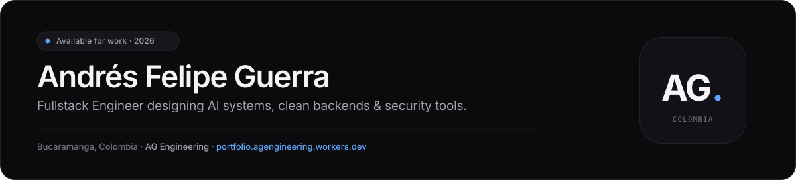
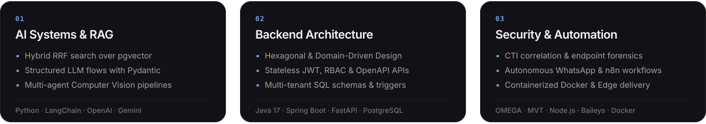
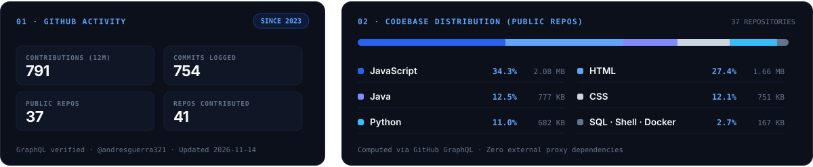

<a href="https://portfolio.agengineering.workers.dev/">
  <picture>
    <source media="(prefers-color-scheme: dark)" srcset="./assets/hero-dark.svg" />
    <source media="(prefers-color-scheme: light)" srcset="./assets/hero-light.svg" />
    
  </picture>
</a>

  

&nbsp;
&nbsp;
&nbsp;
&nbsp;

---

### `01` · Arquitectura y Enfoque Técnico

<picture>
  <source media="(prefers-color-scheme: dark)" srcset="./assets/pillars-dark.svg" />
  <source media="(prefers-color-scheme: light)" srcset="./assets/pillars-light.svg" />
  
</picture>

---

### `02` · Sistemas Destacados

<table width="100%">
  <tr>
    <td width="50%" valign="top">
      
<strong><code>01</code> · <a href="https://github.com/andresguerra321/OMEGA">OMEGA — Threat Intelligence &amp; Forense</a></strong>

      
Plataforma defensiva de ciberinteligencia asistida por RAG híbrido (<code>pgvector</code> + RRF) para correlación de campañas <em>Pegasus/Predator</em>, verificación forense de endpoints (MVT, ADB, iOS, WMI/RAM) y auditoría OSINT pasiva.

      
<code>FastAPI</code> <code>PostgreSQL</code> <code>pgvector</code> <code>React 19</code> <code>Tailwind v4</code> <code>Electron</code>

    </td>
    <td width="50%" valign="top">
      
<strong><code>02</code> · <a href="https://github.com/andresguerra321/proyecto-springboot">ToolRent — SaaS Industrial (DDD)</a></strong>

      
Plataforma empresarial de renta de maquinaria con Arquitectura Hexagonal y Domain-Driven Design en 8 módulos Maven, BD en Cuarta Forma Normal (4FN), Flyway, seguridad JWT RBAC, OpenAPI y SPA.

      
<code>Java 17</code> <code>Spring Boot 3</code> <code>PostgreSQL 16</code> <code>Flyway</code> <code>JWT</code> <code>Vite</code>

    </td>
  </tr>
  <tr>
    <td width="50%" valign="top">
      
<strong><code>03</code> · <a href="https://github.com/andresguerra321/HOJAS-DE-VIDA">Analizador de Hojas de Vida IA</a></strong>

      
Motor de evaluación automatizada de candidatos que compara CVs en PDF frente a requerimientos de vacantes mediante extracción estructurada tipada con Pydantic y cadenas LangChain LCEL.

      
<code>Python 3.12</code> <code>LangChain</code> <code>Pydantic</code> <code>OpenAI</code> <code>Gemini</code> <code>Streamlit</code>

    </td>
    <td width="50%" valign="top">
      
<strong><code>04</code> · <a href="https://github.com/andresguerra321/GUARDIAN">GUARDIAN — Seguridad Vial Multi-Agente</a></strong>

      
Sistema de seguridad predictiva en transporte terrestre con Computer Vision y tres agentes colaborativos (<em>Copiloto · Centinela · Oráculo</em>) construido sobre Voxel51 FiftyOne — Hackathon 2026.

      
<code>Python</code> <code>Voxel51 FiftyOne</code> <code>Gemini AI</code> <code>Computer Vision</code>

    </td>
  </tr>
  <tr>
    <td width="50%" valign="top">
      
<strong><code>05</code> · <a href="https://github.com/andresguerra321/Bot-de-Whatsapp-plantilla-">WA-Bot — Agente Conversacional WhatsApp</a></strong>

      
Asistente IA self-hosted para agendamiento y atención automática 24/7 con memoria de conversación, botones interactivos y respuestas con Groq/LLaMA sin intermediarios de pago por mensaje.

      
<code>Node.js</code> <code>Baileys</code> <code>Groq</code> <code>LLaMA</code> <code>Docker</code>

    </td>
    <td width="50%" valign="top">
      
<strong><code>06</code> · <a href="https://github.com/andresguerra321/Proyectoposgres">SST &amp; PESV Multi-Tenant DB</a></strong>

      
Arquitectura relacional y documental aislada en PostgreSQL para gestión normativa SG-SST y PESV con ciclo PHVA, control de concurrencia, triggers de auditoría y vistas materializadas.

      
<code>PostgreSQL</code> <code>PL/pgSQL</code> <code>Multi-Tenant</code> <code>Docker</code>

    </td>
  </tr>
</table>

<strong>Explorar otros sistemas y laboratorios de arquitectura (4 repositorios)</strong>

 

| Sistema | Enfoque Técnico | Stack |
|---|---|---|
| **[Tribuna Global](https://github.com/andresguerra321/chatbot-futbol)** | Análisis estructurado de sentimientos y suite automatizada anti Prompt Injection | `Python` `Streamlit` `LangChain` `Groq` |
| **[DeliveryBot](https://github.com/andresguerra321/delivery_bot_n8n)** | Automatización de pedidos institucionales en tiempo real | `n8n` `Telegram Bot API` `Python` `Google Sheets` |
| **[Hexagonal Demo App](https://github.com/andresguerra321/hexagonal-demoapp)** | Puertos, adaptadores, patrón Abstract Factory y principios SOLID | `Java` `JDBC` `PostgreSQL` `MySQL` |
| **[AG Engineering Portfolio](https://portfolio.agengineering.workers.dev/)** | Sitio web oficial desplegado en Cloudflare Workers ([código fuente](https://github.com/andresguerra321/paginaweb)) | `HTML` `JavaScript` `CSS` `Cloudflare Workers` |

---

### `03` · Telemetría en Tiempo Real

<picture>
  <source media="(prefers-color-scheme: dark)" srcset="./assets/telemetry-dark.svg" />
  <source media="(prefers-color-scheme: light)" srcset="./assets/telemetry-light.svg" />
  
</picture>

---

### `04` · Stack Tecnológico

| Capa | Tecnologías |
|---|---|
| **Backend & Datos** |        |
| **Frontend & Desktop** |      |
| **IA, RAG & Automatización** |      |
| **Infraestructura & Ops** |     |

---

<a href="https://portfolio.agengineering.workers.dev/">
  <picture>
    <source media="(prefers-color-scheme: dark)" srcset="./assets/footer-dark.svg" />
    <source media="(prefers-color-scheme: light)" srcset="./assets/footer-light.svg" />
    
  </picture>
</a>

