

<a href="https://portfolio.agengineering.workers.dev/"><picture><source media="(prefers-color-scheme: dark)" srcset="./assets/v4/hero-dark.svg" /><source media="(prefers-color-scheme: light)" srcset="./assets/v4/hero-light.svg" /></picture></a>

  

  <a href="https://portfolio.agengineering.workers.dev/"><picture><source media="(prefers-color-scheme: dark)" srcset="./assets/v4/btn-portfolio-dark.svg" /><source media="(prefers-color-scheme: light)" srcset="./assets/v4/btn-portfolio-light.svg" /></picture></a>&nbsp;
  <a href="https://www.linkedin.com/in/andr%C3%A9s-felipe-guerra-correa-556333267/"><picture><source media="(prefers-color-scheme: dark)" srcset="./assets/v4/btn-linkedin-dark.svg" /><source media="(prefers-color-scheme: light)" srcset="./assets/v4/btn-linkedin-light.svg" /></picture></a>&nbsp;
  <a href="mailto:andres.felipe.gueco@gmail.com"><picture><source media="(prefers-color-scheme: dark)" srcset="./assets/v4/btn-email-dark.svg" /><source media="(prefers-color-scheme: light)" srcset="./assets/v4/btn-email-light.svg" /></picture></a>&nbsp;
  <a href="https://es.fiverr.com/s/dDvmP03"><picture><source media="(prefers-color-scheme: dark)" srcset="./assets/v4/btn-fiverr-dark.svg" /><source media="(prefers-color-scheme: light)" srcset="./assets/v4/btn-fiverr-light.svg" /></picture></a>&nbsp;
  <a href="https://wa.me/573185602203"><picture><source media="(prefers-color-scheme: dark)" srcset="./assets/v4/btn-whatsapp-dark.svg" /><source media="(prefers-color-scheme: light)" srcset="./assets/v4/btn-whatsapp-light.svg" /></picture></a>

 

### Enfoque Técnico

<picture><source media="(prefers-color-scheme: dark)" srcset="./assets/v4/pillars-dark.svg" /><source media="(prefers-color-scheme: light)" srcset="./assets/v4/pillars-light.svg" />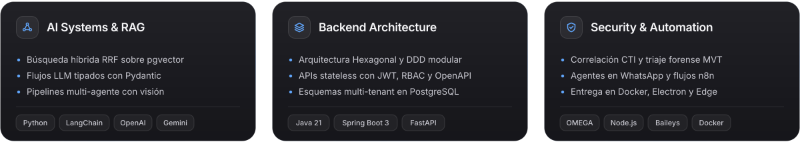</picture>

  

### Sistemas Destacados

  <a href="https://github.com/andresguerra321/OMEGA"><picture><source media="(prefers-color-scheme: dark)" srcset="./assets/v4/proj-omega-dark.svg" /><source media="(prefers-color-scheme: light)" srcset="./assets/v4/proj-omega-light.svg" />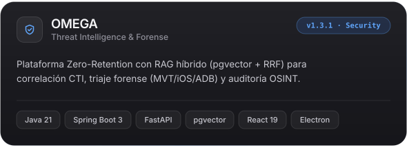</picture></a>&nbsp;&nbsp;<a href="https://github.com/andresguerra321/proyecto-springboot"><picture><source media="(prefers-color-scheme: dark)" srcset="./assets/v4/proj-toolrent-dark.svg" /><source media="(prefers-color-scheme: light)" srcset="./assets/v4/proj-toolrent-light.svg" />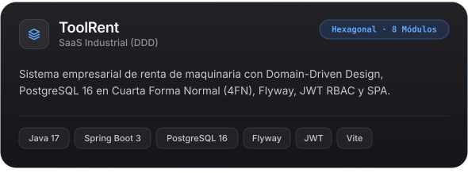</picture></a>

  <a href="https://github.com/andresguerra321/HOJAS-DE-VIDA"><picture><source media="(prefers-color-scheme: dark)" srcset="./assets/v4/proj-cv-dark.svg" /><source media="(prefers-color-scheme: light)" srcset="./assets/v4/proj-cv-light.svg" />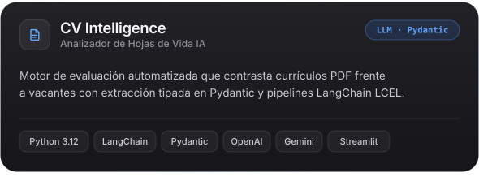</picture></a>&nbsp;&nbsp;<a href="https://github.com/andresguerra321/GUARDIAN"><picture><source media="(prefers-color-scheme: dark)" srcset="./assets/v4/proj-guardian-dark.svg" /><source media="(prefers-color-scheme: light)" srcset="./assets/v4/proj-guardian-light.svg" />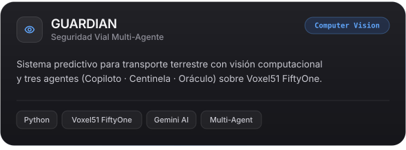</picture></a>

  <a href="https://github.com/andresguerra321/Bot-de-Whatsapp-plantilla-"><picture><source media="(prefers-color-scheme: dark)" srcset="./assets/v4/proj-wabot-dark.svg" /><source media="(prefers-color-scheme: light)" srcset="./assets/v4/proj-wabot-light.svg" />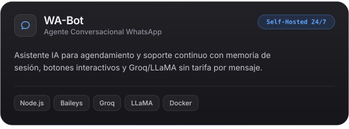</picture></a>&nbsp;&nbsp;<a href="https://github.com/andresguerra321/Proyectoposgres"><picture><source media="(prefers-color-scheme: dark)" srcset="./assets/v4/proj-postgres-dark.svg" /><source media="(prefers-color-scheme: light)" srcset="./assets/v4/proj-postgres-light.svg" />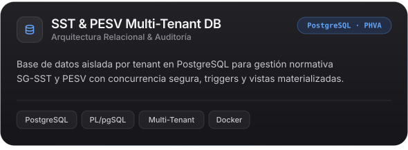</picture></a>

 

### Otros Sistemas &amp; Laboratorios

  <a href="https://github.com/andresguerra321/chatbot-futbol"><picture><source media="(prefers-color-scheme: dark)" srcset="./assets/v4/mini-tribuna-dark.svg" /><source media="(prefers-color-scheme: light)" srcset="./assets/v4/mini-tribuna-light.svg" />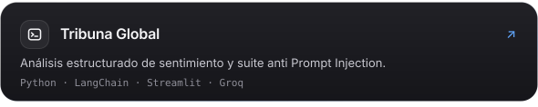</picture></a>&nbsp;&nbsp;<a href="https://github.com/andresguerra321/delivery_bot_n8n"><picture><source media="(prefers-color-scheme: dark)" srcset="./assets/v4/mini-deliverybot-dark.svg" /><source media="(prefers-color-scheme: light)" srcset="./assets/v4/mini-deliverybot-light.svg" />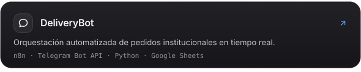</picture></a>

  <a href="https://github.com/andresguerra321/hexagonal-demoapp"><picture><source media="(prefers-color-scheme: dark)" srcset="./assets/v4/mini-hexagonal-dark.svg" /><source media="(prefers-color-scheme: light)" srcset="./assets/v4/mini-hexagonal-light.svg" />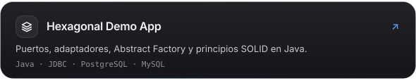</picture></a>&nbsp;&nbsp;<a href="https://portfolio.agengineering.workers.dev/"><picture><source media="(prefers-color-scheme: dark)" srcset="./assets/v4/mini-portfolio-dark.svg" /><source media="(prefers-color-scheme: light)" srcset="./assets/v4/mini-portfolio-light.svg" />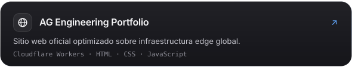</picture></a>

 

### Telemetría

<picture><source media="(prefers-color-scheme: dark)" srcset="./assets/v4/telemetry-dark.svg" /><source media="(prefers-color-scheme: light)" srcset="./assets/v4/telemetry-light.svg" />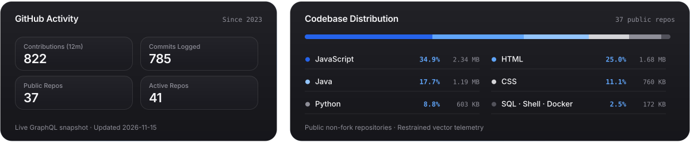</picture>

  

### Stack Tecnológico

<picture><source media="(prefers-color-scheme: dark)" srcset="./assets/v4/stack-dark.svg" /><source media="(prefers-color-scheme: light)" srcset="./assets/v4/stack-light.svg" />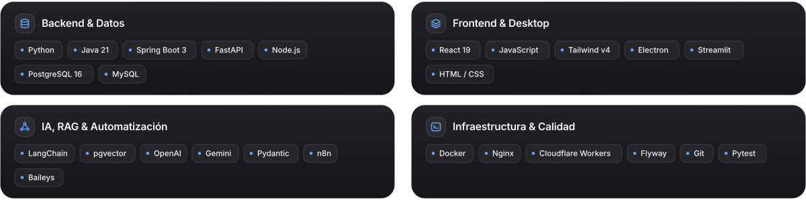</picture>

  

<a href="https://portfolio.agengineering.workers.dev/"><picture><source media="(prefers-color-scheme: dark)" srcset="./assets/v4/footer-dark.svg" /><source media="(prefers-color-scheme: light)" srcset="./assets/v4/footer-light.svg" />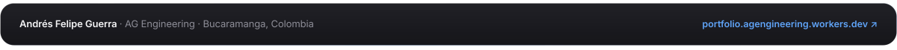</picture></a>

