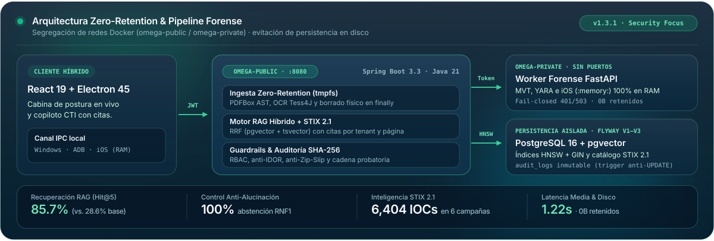
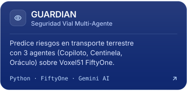
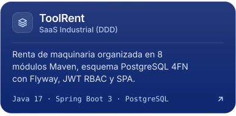
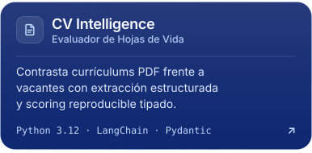

<a href="https://portfolio.agengineering.workers.dev/"><picture><source media="(prefers-color-scheme: dark)" srcset="./assets/v6/hero-dark.svg" /><source media="(prefers-color-scheme: light)" srcset="./assets/v6/hero-light.svg" /></picture></a>

  

  <a href="https://portfolio.agengineering.workers.dev/"><picture><source media="(prefers-color-scheme: dark)" srcset="./assets/v6/btn-portfolio-dark.svg" /><source media="(prefers-color-scheme: light)" srcset="./assets/v6/btn-portfolio-light.svg" /></picture></a>&nbsp;
  <a href="https://www.linkedin.com/in/andr%C3%A9s-felipe-guerra-correa-556333267/"><picture><source media="(prefers-color-scheme: dark)" srcset="./assets/v6/btn-linkedin-dark.svg" /><source media="(prefers-color-scheme: light)" srcset="./assets/v6/btn-linkedin-light.svg" /></picture></a>&nbsp;
  <a href="mailto:andres.felipe.gueco@gmail.com"><picture><source media="(prefers-color-scheme: dark)" srcset="./assets/v6/btn-email-dark.svg" /><source media="(prefers-color-scheme: light)" srcset="./assets/v6/btn-email-light.svg" /></picture></a>&nbsp;
  <a href="https://es.fiverr.com/s/dDvmP03"><picture><source media="(prefers-color-scheme: dark)" srcset="./assets/v6/btn-fiverr-dark.svg" /><source media="(prefers-color-scheme: light)" srcset="./assets/v6/btn-fiverr-light.svg" /></picture></a>&nbsp;
  <a href="https://wa.me/573185602203"><picture><source media="(prefers-color-scheme: dark)" srcset="./assets/v6/btn-whatsapp-dark.svg" /><source media="(prefers-color-scheme: light)" srcset="./assets/v6/btn-whatsapp-light.svg" /></picture></a>

 

## OMEGA · Inteligencia defensiva contra spyware comercial

  

 

Plataforma defensiva para detectar y analizar spyware comercial (*Pegasus*, *Predator*, *Candiru*), correlacionar inteligencia de amenazas (CTI) y ejecutar triaje forense en dispositivos sin persistir evidencia sensible.

- **El problema:** Investigar spyware móvil exige cruzar manualmente reportes CTI extensos y respaldos sensibles de víctimas sin filtrar datos ni depender de respuestas LLM sin respaldo documental.
- **El enfoque:** Gateway `Spring Boot 3` con ingesta en `tmpfs` (borrado físico en `finally`), worker forense `FastAPI` aislado sin puertos públicos (MVT, YARA e iOS en `:memory:`), búsqueda híbrida RRF (`pgvector` + `tsvector`) y auditoría encadenada por `SHA-256`.
- **Resultado (`v1.3.1`):** **85.7% Hit@5** en recuperación híbrida (vs. 28.6% vectorial base), **100% de abstención anti-alucinación** fuera de corpus, **6,404 indicadores STIX 2.1** en 6 campañas, latencia media neta de **1.22s** y app Windows empaquetada en Electron.

 

<a href="https://github.com/andresguerra321/OMEGA"><picture><source media="(prefers-color-scheme: dark)" srcset="./assets/v6/omega-arch-dark.svg" /><source media="(prefers-color-scheme: light)" srcset="./assets/v6/omega-arch-light.svg" /></picture></a>

  

`Java 21` `Spring Boot 3.3` `FastAPI` `PostgreSQL 16` `pgvector` `React 19` `Electron 45`

**[Ver repositorio](https://github.com/andresguerra321/OMEGA)** · **[Arquitectura Zero-Retention](https://github.com/andresguerra321/OMEGA/blob/main/omega/backend-java/README.md)** · **[Evaluación RAGAS](https://github.com/andresguerra321/OMEGA/blob/main/omega/rag_engine/eval/ablation_report_v1.md)** · **[Release Desktop v1.3.1](https://github.com/andresguerra321/OMEGA/releases/tag/v1.3.1)**

 

### Proyectos Secundarios

  <a href="https://github.com/andresguerra321/GUARDIAN"><picture><source media="(prefers-color-scheme: dark)" srcset="./assets/v6/sec-guardian-dark.svg" /><source media="(prefers-color-scheme: light)" srcset="./assets/v6/sec-guardian-light.svg" /></picture></a>&nbsp;&nbsp;&nbsp;<a href="https://github.com/andresguerra321/proyecto-springboot"><picture><source media="(prefers-color-scheme: dark)" srcset="./assets/v6/sec-toolrent-dark.svg" /><source media="(prefers-color-scheme: light)" srcset="./assets/v6/sec-toolrent-light.svg" /></picture></a>&nbsp;&nbsp;&nbsp;<a href="https://github.com/andresguerra321/HOJAS-DE-VIDA"><picture><source media="(prefers-color-scheme: dark)" srcset="./assets/v6/sec-cv-dark.svg" /><source media="(prefers-color-scheme: light)" srcset="./assets/v6/sec-cv-light.svg" /></picture></a>

 

### Otros sistemas

- **[WA-Bot](https://github.com/andresguerra321/Bot-de-Whatsapp-plantilla-)** — Agente conversacional self-hosted en WhatsApp con memoria de sesión y botones interactivos sin tarifa por mensaje (`Node.js · Baileys · Groq · Docker`).
- **[SST & PESV Multi-Tenant DB](https://github.com/andresguerra321/Proyectoposgres)** — Modelo PostgreSQL aislado por tenant para gestión normativa SG-SST y PESV con ciclo PHVA, triggers de auditoría y vistas materializadas.
- **[Tribuna Global](https://github.com/andresguerra321/chatbot-futbol)** — Chatbot de análisis de sentimientos con guardrails y suite de pruebas anti-Prompt Injection (`Python · LangChain · Streamlit · Groq`).
- **[DeliveryBot](https://github.com/andresguerra321/delivery_bot_n8n)** — Orquestación automatizada de pedidos institucionales en tiempo real (`n8n · Telegram Bot API · Python · Google Sheets`).
- **[Hexagonal Demo App](https://github.com/andresguerra321/hexagonal-demoapp)** — Implementación de referencia en arquitectura hexagonal, puertos/adaptadores y Abstract Factory (`Java · JDBC · PostgreSQL · MySQL`).
- **[AG Engineering Portfolio](https://portfolio.agengineering.workers.dev/)** — Sitio web oficial optimizado sobre infraestructura edge global (`Cloudflare Workers`).

 

<a href="https://portfolio.agengineering.workers.dev/"><picture><source media="(prefers-color-scheme: dark)" srcset="./assets/v6/footer-dark.svg" /><source media="(prefers-color-scheme: light)" srcset="./assets/v6/footer-light.svg" /></picture></a>

