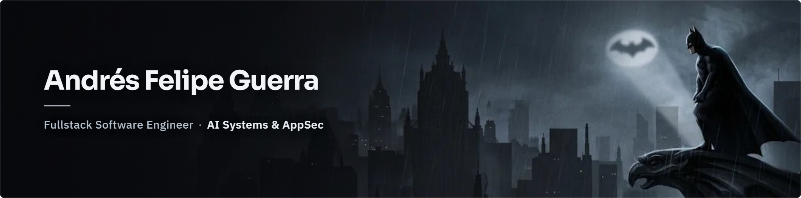
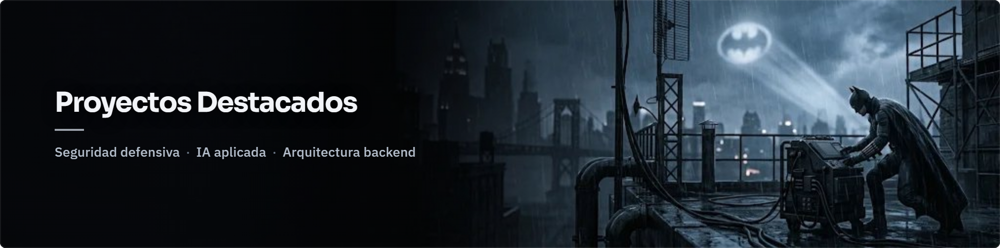
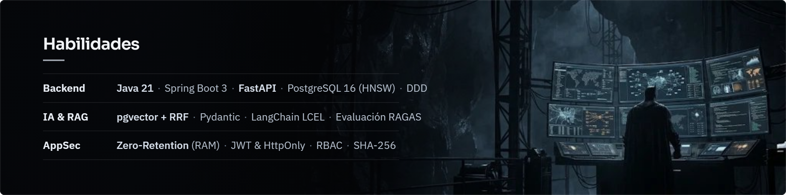

Desarrollador fullstack en Colombia — arquitectura backend, sistemas de **IA aplicada** y seguridad defensiva, rumbo a **Cloud & AI Security**.

<table>
  <tr>
    <td width="50%" valign="top">
      <strong><a href="https://github.com/andresguerra321/OMEGA">OMEGA</a></strong> · <code>v2.1.0</code> 
      Threat Intelligence, AppSec &amp; Forense Zero-Retention  
      Plataforma defensiva multi-tenant con espacios adaptativos (General, Developer y Legal), escáner de repositorios/SBOM, correlación CTI/OSINT, triaje forense en RAM, RAG híbrido (<code>pgvector</code> + RRF), 2FA e integridad <code>Ed25519</code>/<code>SHA-256</code>.  
      Java 21 · Spring Boot 3 · FastAPI · React 19 · Tauri v2 (Rust) 
      <a href="https://github.com/andresguerra321/OMEGA/blob/main/omega/backend-java/README.md">Arquitectura</a> · <a href="https://github.com/andresguerra321/OMEGA/blob/main/omega/rag_engine/eval/ablation_report_v1.md">RAGAS</a> · <a href="https://github.com/andresguerra321/OMEGA/releases">Releases (v2.1.0)</a>
    </td>
    <td width="50%" valign="top">
      <strong><a href="https://github.com/andresguerra321/GUARDIAN">GUARDIAN</a></strong> 
      Seguridad Vial Multi-Agente · Computer Vision  
      Pipeline multi-agente para inspección de escenas viales y detección automatizada de condiciones de riesgo mediante visión computacional.  
      Python · Voxel51 FiftyOne · Gemini AI
    </td>
  </tr>
  <tr>
    <td width="50%" valign="top">
      <strong><a href="https://github.com/andresguerra321/HOJAS-DE-VIDA">CV Intelligence</a></strong> 
      Evaluación Estructurada de Perfiles con LLMs  
      Motor de análisis y contraste tipado de hojas de vida frente a vacantes técnicas mediante extracción con esquemas validados.  
      Python 3.12 · LangChain · Pydantic
    </td>
    <td width="50%" valign="top">
      <strong><a href="https://github.com/andresguerra321/proyecto-springboot">ToolRent</a></strong> 
      SaaS de Gestión y Renta Industrial  
      Plataforma empresarial modularizada en 8 módulos Maven bajo arquitectura limpia, modelo relacional normalizado y autenticación JWT.  
      Java 17 · Spring Boot 3 · PostgreSQL 4FN · JWT
    </td>
  </tr>
</table>

---

  &nbsp;&nbsp;&nbsp;&nbsp;&nbsp;&nbsp;&nbsp;&nbsp;
    
  Bucaramanga, Colombia

